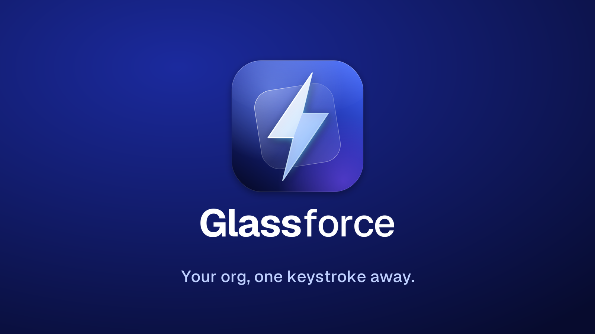

<p align="center">
  <a href="https://glassforce-preview.breezy-otter-7121.chatgpt.site/">
    
  </a>
</p>

<p align="center">
  <strong>Find the record. Keep your flow.</strong><br />
  A native macOS 26 command bar for Salesforce, built with Liquid Glass.<br />
  Press <kbd>⌥ Space</kbd> from any app, search your org, and open a record in Lightning.
</p>

<p align="center">
  <a href="#install-status"><strong>Build from source ↗</strong></a> &nbsp; · &nbsp;
  <a href="https://glassforce-preview.breezy-otter-7121.chatgpt.site/">Visit the website</a> &nbsp; · &nbsp;
  <a href="ARCHITECTURE.md">Read the architecture</a>
</p>

<p align="center">
  
  
  <a href="LICENSE"></a>
  <a href="#install-status"></a>
</p>

<p align="center">
  <sub>No published download or Homebrew tap yet. This is a source release candidate, not a supported binary release.</sub>
</p>

<br />

<a name="what-the-app-does"></a>
<h2 align="center">Your next record is a shortcut away.</h2>

<p align="center">
  Search by prefix, acronym, or a name you almost remember.<br />
  Move with the arrow keys. Press Return to open the result in Lightning.
</p>

<p align="center">
  
</p>

<p align="center">
  <sub>Scripted mock capture from <code>eae6d2a</code>, using synthetic records.<br />
  The older capture says Sandbox and shows <code>127.0.0.1</code>. It is not a live-org test or a screenshot of the latest candidate.</sub>
</p>

<br />

<h2 align="center">Less hunting. More doing.</h2>

<p align="center">The record, its preview, and the next action in one panel.</p>

<table>
  <tr>
    <td width="50%" valign="top"><strong>Find it your way.</strong><br />Prefix, acronym, and typo matching over a local SQLite FTS cache.</td>
    <td width="50%" valign="top"><strong>Keep your hands on the keyboard.</strong><br />Open the selected record or copy its link from the <kbd>⌘ K</kbd> actions menu.</td>
  </tr>
  <tr>
    <td valign="top"><strong>See the change before it happens.</strong><br />A supported opportunity stage update shows the exact change. The app writes only after you click Confirm.</td>
    <td valign="top"><strong>Choose what you search.</strong><br />Settings lists eligible standard and custom objects from your org. Select which ones to sync and search.</td>
  </tr>
</table>

<p align="center">
  <sub>Stage updates use the cached before-value, not server-side optimistic concurrency.<br />Another user's later change can be overwritten. Do not rely on this flow to detect server conflicts.</sub>
</p>

<details>
<summary><strong>The keys to know</strong></summary>
<br />

| Shortcut | Action |
| --- | --- |
| **⌥ Space** | Show the command bar from any app. |
| **↑ / ↓** | Move through search results. |
| **Return** | Open the selected record in Lightning. |
| **⌘ K** | Show Open and Copy Link actions. |
| **⌘ C** | Copy the selected record link when the search field has no text selection. |
| **⌘ ,** | Open Settings. |
| **Esc** | Dismiss the panel. |

To move a window, drag the search icon in the command bar or the top edge of the setup card. Text fields and action buttons keep their normal click behavior.

</details>

<br />

<a name="privacy"></a>
<h2 align="center">Your Mac. Your org. A clear connection.</h2>

<p align="center">Sign in to Salesforce with OAuth and PKCE. Choose the org before the first sync.</p>

- **Credentials stay separate.** Refresh tokens live in this device's macOS Keychain, not iCloud Keychain. Access tokens stay in memory. Tokens are not stored with records.
- **Search runs on a local cache.** Synced record fields live in SQLite and JSON under `~/Library/Application Support/Glassforce`. This cache is **not application-encrypted** and may contain sensitive org data.
- **No telemetry.** The app has no analytics, crash reporting, or third-party SDKs.
- **Salesforce handles sign-in.** Glassforce does not collect your Salesforce password or MFA codes. Normal sign-in, sync, and update flows use Salesforce endpoints. The app trusts Salesforce token responses for instance and identity URLs; automatic HTTP redirects are refused.

<p align="center">
  <a href="ARCHITECTURE.md">How it works</a> · <a href="SECURITY.md">Security and reporting</a>
</p>

<br />

<a name="install-status"></a>
<h2 align="center">Build Glassforce.</h2>

<p align="center">
  The source is here. The public download is not ready yet.<br />
  Build locally on <strong>macOS 26</strong> with <strong>Xcode 26</strong> or the <strong>Swift 6.2 Command Line Tools</strong>.
</p>

```sh
git clone --branch release/readiness-20261111 https://github.com/srikolagani/glassforce-public.git
cd glassforce-public
GLASSFORCE_SIGN_IDENTITY=- scripts/build-app.sh release
open build/Glassforce.app
```

The first build can take a few minutes. This command builds an **ad-hoc signed app** without creating a certificate, changing Keychain settings, or replacing an installed app. It does not imply a Developer ID signature or notarization.

macOS may require approval in **System Settings → Privacy & Security → Open Anyway**. Leave Gatekeeper and quarantine enabled.

<details>
<summary><strong>If SwiftPM rejects the manifest</strong></summary>
<br />

If SwiftPM reports `reference to member 'v26'` or `undefined symbol Package.__allocating_init`, the Command Line Tools may have stale private interface files. Reinstall the tools, or use a cleaned copy without changing the installed toolchain:

```sh
PM="$HOME/Library/Caches/glassforce-swiftpm"
mkdir -p "$PM"
cp -R /Library/Developer/CommandLineTools/usr/lib/swift/pm/ManifestAPI /Library/Developer/CommandLineTools/usr/lib/swift/pm/PluginAPI "$PM"/
find "$PM" -name '*.private.swiftinterface' -delete
export SWIFTPM_CUSTOM_LIBS_DIR="$PM"
GLASSFORCE_SIGN_IDENTITY=- scripts/build-app.sh release
```

</details>

<br />

<a name="connect-your-org"></a>
<h2 align="center">Connect your org. Make it your own.</h2>

<p align="center">An admin installs the Glassforce package once per Salesforce org.<br />Each user signs in and confirms the org shown by the app.</p>

1. Press **⌥ Space** or choose **Search Salesforce** from the menu bar, then choose **Get Started**.
2. Choose **Production**, **Sandbox**, or your Salesforce **My Domain**. An admin installs the Glassforce package. If it is already installed, choose **Skip**.
3. Choose **Connect**, sign in to Salesforce, and click **Allow**.
4. Check the **org name, username, and instance host**. Choose **Use this org** to save the OAuth sign-in in Keychain and start syncing. Choose **Sign in to a different org** if the card is wrong.
5. When sync finishes, search with **⌥ Space**. Use the gear in the panel or **⌘ ,** to change searchable objects.

<br />

<a name="verification-and-packaging"></a>
<h2 align="center">Know what has been tested.</h2>

<p align="center">
  This repository contains a sanitized source snapshot and synthetic fixtures.<br />
  Native tests use mocks. They do not certify package installation or Salesforce writes in your org.
</p>

<details>
<summary><strong>Run the checks and package a candidate</strong></summary>
<br />

```sh
scripts/test.sh
scripts/release.sh
```

Release packaging requires a **clean Git checkout**. It produces an ad-hoc signed DMG, checksums, and generated casks in `build/release` without publishing or changing tracked source. The DMG has an Applications shortcut; drag Glassforce into Applications to install. Generated casks are not a published Homebrew tap.

Before public distribution, verify the packaged app on a clean Mac and complete an authorized Salesforce sandbox sign-in and sync. Any test update needs approval for the record and exact change. No Developer ID signature or notarization is implied.

See the [release-candidate test guide](docs/how-to-test.md) for automated checks, an isolated panel smoke test, installer checks, and manual acceptance.

</details>

<p align="center">
  <a href="docs/how-to-test.md">Test guide</a> · <a href="ARCHITECTURE.md">Architecture</a> · <a href="CHANGELOG.md">Changelog</a>
</p>

<br />

<h2 align="center">Build with us.</h2>

<p align="center">
  Glassforce is open source under the MIT license.<br />
  Read <a href="CONTRIBUTING.md">CONTRIBUTING</a> to build, test, and send a change.
</p>

<p align="center">
  <a href="https://github.com/srikolagani/glassforce-public/issues/new/choose">Report a bug</a> ·
  <a href="SECURITY.md">Report a vulnerability</a> ·
  <a href="CODE_OF_CONDUCT.md">Code of conduct</a>
</p>

<br />

<a name="license"></a>
<p align="center">
  <sub>Copyright 2026 Sri Kolagani · <a href="LICENSE">MIT License</a><br />
  Glassforce is independent software and is not affiliated with, sponsored by, or endorsed by Salesforce, Inc.<br />
  Salesforce is a trademark of Salesforce, Inc.</sub>
</p>
