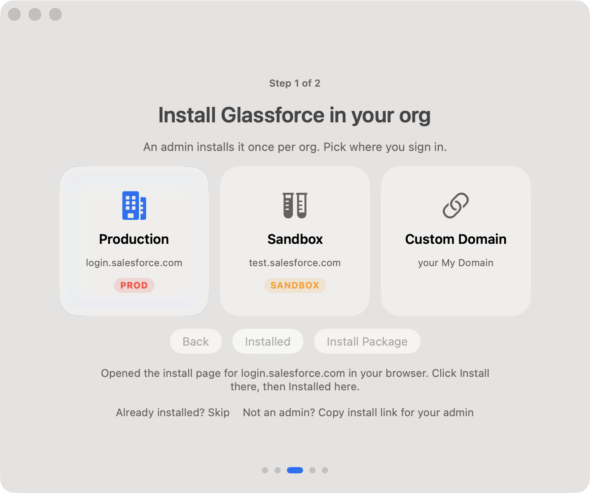

# Glassforce

Spotlight for Salesforce. A native macOS command bar: press **Option-Space**, type a few letters, hit Return, and the record opens in Lightning.


Scripted mock demonstration captured at `eae6d2a`. The records are synthetic. The chip in the picture says **Sandbox · Acme Corp (UAT)**, not Demo, and the preview host is `127.0.0.1`. This is not a production org and not proof of later preview spacing or Demo labeling.

## What works today

- **Option-Space from any app.** A Liquid Glass panel on the active display. No Dock icon.
- **Fuzzy search over your org.** Prefix, acronym and typo matching over a local SQLite cache, ranked by title, then subtitle, then object, with a boost for records you open often. Arrow keys move, Return opens, Cmd-C copies the link. `scripts/bench.sh` measures p95 on 10,000 synthetic records (2.5 ms in the latest run, on a release build on an M-series Mac).
- **Inline preview and Cmd-K.** The selected row shows its type, title, and host. Cmd-K opens Open and Copy Link.
- **A stage change you confirm.** `move acme deal to closed won` shows the diff. Nothing is written until you click Confirm.
- **Pick what to search.** The gear at the top right of the search bar, next to the org badge, opens Settings. It lists the objects in your org, custom ones included. An empty object says **0 synced** there, and stays quiet in the search bar.
- **One-click connect.** An admin installs the Glassforce package once per org, then each user signs in with OAuth (PKCE) and clicks Allow. Tokens stay in the Keychain. No telemetry.

The earlier typo-search and Settings pictures showed a real org badge. They are no longer embedded. A matching mock proof is not available yet.

## Install

Build from source, below. There is no published download and no Homebrew tap yet.

A future disk image is ad-hoc signed. Developer ID signing and notarization are optional: set `GLASSFORCE_SIGN_IDENTITY` and `GLASSFORCE_NOTARY_PROFILE` only when those credentials exist. macOS will say an ad-hoc app is from an unidentified developer. The supported approval is **System Settings → Privacy & Security → Open Anyway**. Leave Gatekeeper and quarantine on.

## Build from source

You need macOS 26 and either Xcode 26 or the Swift 6.2 Command Line Tools (`xcode-select --install`).

**1. Clone**

```sh
git clone git@github.com:srikolagani/glassforce.git
cd glassforce
```

The packaged External Client App's consumer key is a **public** OAuth client id (PKCE; no client secret). It ships in the source, so a fresh clone needs no env file. Maintainers can still override it with `config/glassforce.local.env` for packaging experiments.

**2. Build, install and launch**

```sh
scripts/dev-signing.sh   # once: a stable local signing identity, so the Keychain stops re-asking after rebuilds
scripts/install.sh       # builds a release app, copies it to /Applications and opens it
```

`dev-signing.sh` prints the identity with `CSSMERR_TP_NOT_TRUSTED`. That's expected for a self-signed local certificate. The first release build takes about 2 minutes.

If SwiftPM fails on `Package.swift` with errors like `reference to member 'v26'` or `undefined symbol Package.__allocating_init`, your Command Line Tools ship stale `*.private.swiftinterface` files. Reinstall the Command Line Tools, or work around it without sudo:

```sh
PM=~/Library/Caches/glassforce-swiftpm
mkdir -p "$PM"
cp -R /Library/Developer/CommandLineTools/usr/lib/swift/pm/ManifestAPI /Library/Developer/CommandLineTools/usr/lib/swift/pm/PluginAPI "$PM"/
find "$PM" -name '*.private.swiftinterface' -delete
export SWIFTPM_CUSTOM_LIBS_DIR="$PM"
scripts/install.sh
```

The `export` lasts for that terminal only. Set it again before rebuilding in a new one.

## Get started



1. Glassforce does not open a window by itself. Click the bolt in the menu bar and choose **Search Salesforce** (or press **Option-Space**). Then **Get Started**, and **Continue** past the Option-Space tip.
2. **Install Glassforce in your org** (admins, once per org). Pick Production, Sandbox or Custom Domain. For a Developer Edition or any org with a My Domain, pick **Custom Domain** and enter its host, for example `acme-dev-ed.develop.my.salesforce.com`. Click **Install Package**, and finish the install in the browser page that opens. Back in Glassforce, click **Proceed to next step**. Not an admin? Use **Copy install link**. Already installed? **Skip**.
3. **Connect your org.** Click **Connect**, sign in to Salesforce, click **Allow**. Glassforce always opens an ephemeral sign-in sheet so a leftover browser session cannot silently pick the wrong org.
4. **Confirm the org.** Glassforce shows the org name, username and instance host. Click **Use this org** to save the sign-in to the Keychain and start syncing, or **Sign in to a different org** to try again. Nothing is saved until you confirm.
5. Glassforce syncs, then shows **Start Searching**. Press **Option-Space** anywhere, type, and press Return (or click a row) to open the record in Lightning.

Settings (**⌘,** or the gear in the panel) picks which objects are searched:

The Settings picture that named a real org is no longer embedded.

## Privacy

- No telemetry, analytics or crash reporting, and no third-party SDKs.
- Network calls go only to the Salesforce org you signed in to.
- OAuth tokens live in the macOS Keychain (this device only, not synced to iCloud). Glassforce never sees your password or MFA codes; Salesforce collects them in the system sign-in sheet.
- Synced record fields are cached as JSON in `~/Library/Application Support/Glassforce` so search doesn't wait on the network. No tokens are stored there.
- There is no client secret. Glassforce is a public OAuth client protected by PKCE.

Details and how to report a vulnerability: [SECURITY.md](SECURITY.md).

## Uninstall

```sh
pkill -x Glassforce; rm -rf /Applications/Glassforce.app ~/Applications/Glassforce.app
rm -rf ~/Library/Application\ Support/Glassforce ~/Library/Logs/Glassforce
defaults delete com.srikolagani.glassforce 2>/dev/null
security delete-generic-password -s dev.glassforce.oauth   # repeat until it says the item could not be found
```

In Salesforce, an admin can remove the package under Setup › Installed Packages.

## More

- [ARCHITECTURE.md](ARCHITECTURE.md): how the shell, auth, sync and search fit together
- [CONTRIBUTING.md](CONTRIBUTING.md): build, test and PR rules

## License

[MIT](LICENSE). Copyright 2026 Sri Kolagani.

Salesforce is a trademark of Salesforce, Inc. Glassforce is not affiliated with, sponsored by, or endorsed by Salesforce, Inc.
