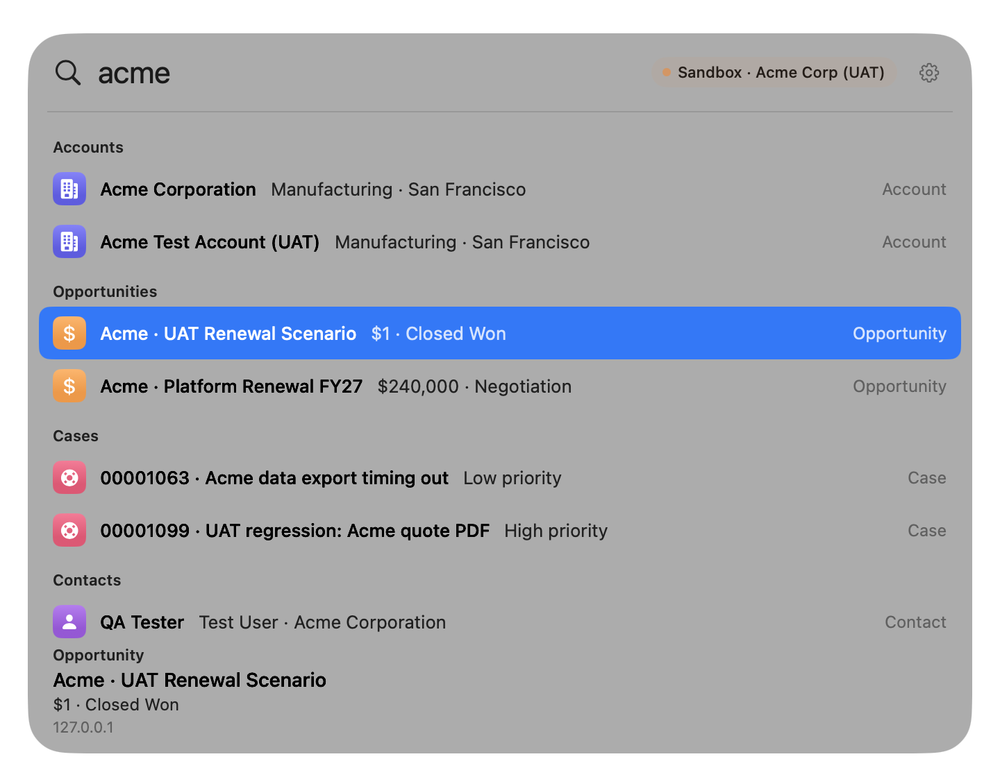

# Glassforce

Your org, one keystroke away.

A native macOS command bar for Salesforce. Press **⌥ Space**, type a few letters, and the record opens in Lightning.

<p align="center">
  
</p>

<p align="center">
  <em>Fixture still, holding the place for a current recording. Scripted mock at <code>eae6d2a</code>. Synthetic records. The chip says Sandbox · Acme Corp (UAT), not Demo. Host <code>127.0.0.1</code>.</em>
</p>

## Search

Fuzzy matching runs on a local cache: prefixes, acronyms, and typos. Results stay grouped by object. Records you open often rank higher.

A stage change such as `move acme deal to closed won` shows the before and after. Nothing is written until you click **Confirm**.

| Key | Does |
| --- | --- |
| ⌥ Space | Open search from any app |
| ↑ ↓ | Move through results |
| Return | Open the record in Lightning |
| Esc | Dismiss the panel |
| ⌘K | Open, or copy the link |
| ⌘C | Copy the link when the query has no selection |
| ⌘, | Choose which objects sync |

The selected row shows its type, title, and host. The panel follows the system appearance, uses no Dock icon, and needs no Accessibility permission.

## Your org

An admin installs the package once. Each person signs in with OAuth (PKCE) and confirms the org name, username, and host before anything is saved. Production, Sandbox, and a My Domain are separate choices.

Search covers the objects you leave on. The defaults are Accounts, Contacts, Opportunities, Cases, Leads, Reports, and Setup pages. Custom objects can be added from the gear beside the org chip. An object with nothing synced stays out of the results.

More than one org can be signed in. Search uses the default org.

## Requirements

macOS 26 (Tahoe). Xcode 26, or the Swift 6.2 Command Line Tools. The app’s minimum system version is 26.0.

## Availability

There is no download and no Homebrew tap. Homebrew has not been published or tested. A current build is ad-hoc signed, and Gatekeeper rejects it. Leave Gatekeeper on. For an app you built yourself, the approval path is **System Settings → Privacy & Security → Open Anyway**.

## Build from source

```sh
git clone https://github.com/srikolagani/glassforce-public.git
cd glassforce-public
scripts/install.sh
```

That builds a release app and copies it to `/Applications`. The public OAuth client id is already in the source. Glassforce stays in the menu bar until you choose **Search Salesforce** or press **⌥ Space**.

`scripts/dev-signing.sh` creates a self-signed local identity so the Keychain can keep allowing the app across rebuilds. It is not a Developer ID. If SwiftPM rejects the package manifest, the workaround is in [CONTRIBUTING.md](CONTRIBUTING.md).

## Privacy

No telemetry, analytics, crash reporting, or third-party SDKs. Traffic goes to the Salesforce org you signed in to. The development mock stays on `127.0.0.1`.

Tokens live in the macOS Keychain for this device only. Glassforce does not see your password or MFA codes. The search cache is under `~/Library/Application Support/Glassforce`, and it does not hold tokens. There is no client secret.

[SECURITY.md](SECURITY.md)

## Also

[Architecture](ARCHITECTURE.md) · [Contributing](CONTRIBUTING.md) · [MIT License](LICENSE)

Copyright 2026 Sri Kolagani.

Salesforce is a trademark of Salesforce, Inc. Glassforce is not affiliated with, sponsored by, or endorsed by Salesforce, Inc.

<details>
<summary>Remove from this Mac</summary>

```sh
pkill -x Glassforce
rm -rf /Applications/Glassforce.app ~/Applications/Glassforce.app
rm -rf ~/Library/Application\ Support/Glassforce ~/Library/Logs/Glassforce
defaults delete com.srikolagani.glassforce 2>/dev/null
security delete-generic-password -s dev.glassforce.oauth
```

Repeat the Keychain command until the item is gone. An admin removes the package in Salesforce under Setup → Installed Packages.

</details>
