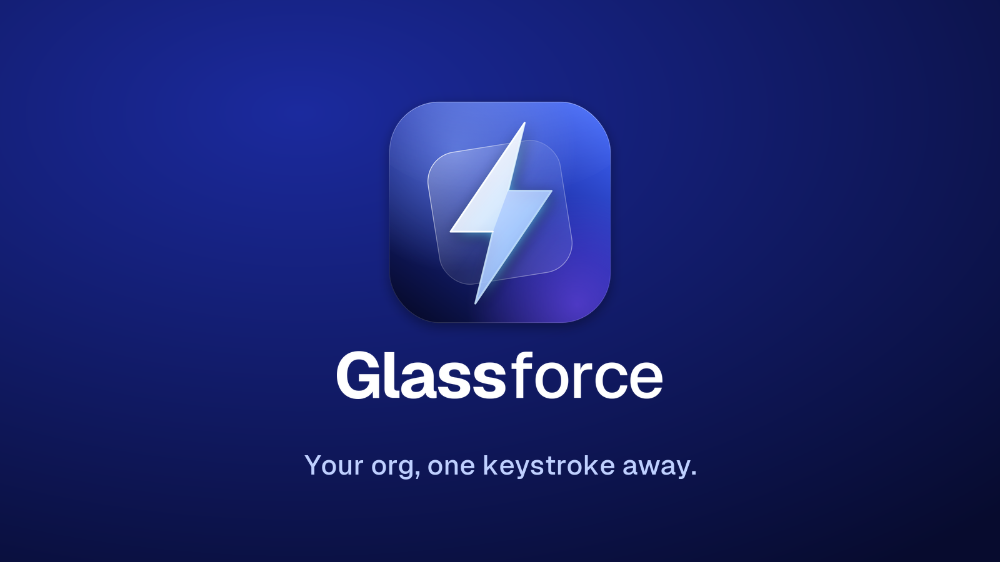
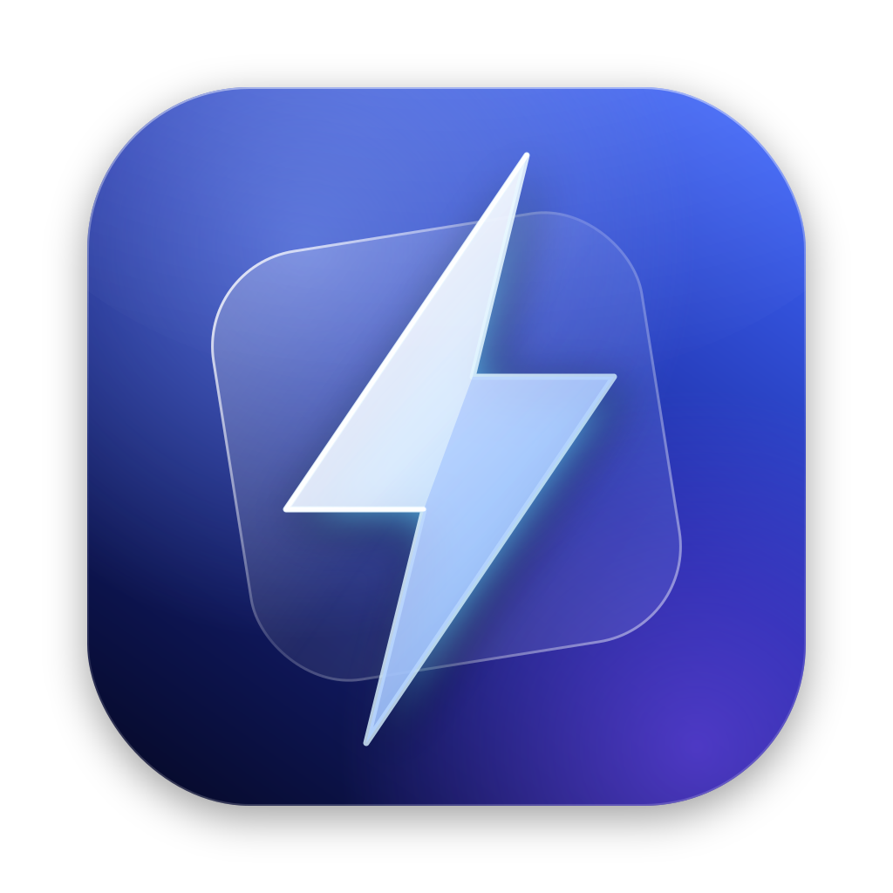
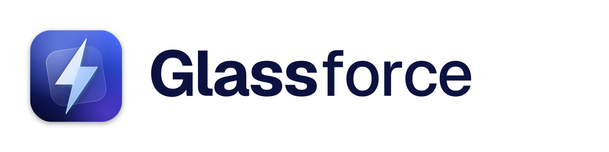
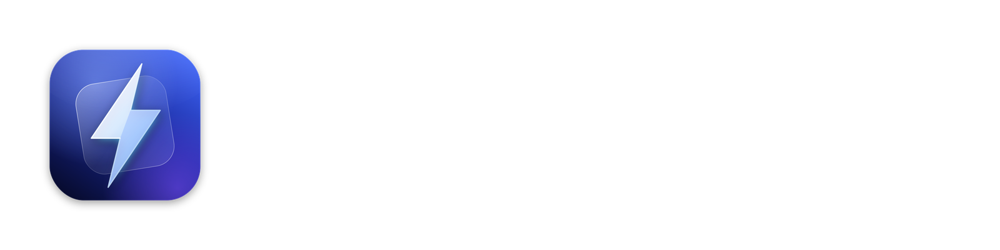
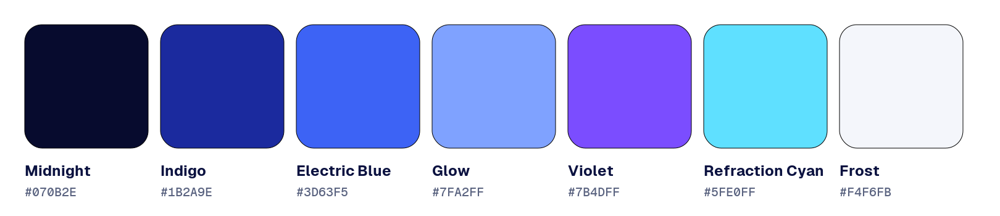

# Glassforce brand guide

## Name

**Glassforce**: one word, capital *G*, lowercase *f*. Never "GlassForce", "Glass Force" or "GF".

## Tagline

**Your org, one keystroke away.**

Short form for tight spaces: *Salesforce, at the speed of ⌥ Space.*

## Voice

Calm, precise and fast. Talk about what the user gets done, not about us. Plain words, short sentences, no hype. Privacy is a promise; say it simply: "Your tokens stay in your Keychain."

## App icon

A faceted **glass lightning shard** over a tilted **glass pane**, on a deep indigo field: speed (the bolt) through clarity (the glass), in the macOS 26 Liquid Glass style.

- Source of truth: `docs/brand/make_icon.py`. Regenerate everything with `cd docs/brand && python3 make_icon.py && python3 make_assets.py ../.. && rm AppIcon-1024.png` (needs `pip install cairosvg pillow` and the Geist font).
- App bundle: `Resources/AppIcon.iconset` → `AppIcon.icns`, packaged by `scripts/build-app.sh`.
- Follows Apple's macOS icon grid: an 824 px rounded square with a soft drop shadow on a 1024 px canvas.

**Do**
- Use the provided PNGs at their native aspect ratio, with clear space of at least ¼ of the icon width.
- Place the icon on neutral light or dark backgrounds.

**Don't**
- Recolour, rotate, stretch, outline or add effects to the icon.
- Place the bolt alone without the indigo tile in product contexts. The bolt by itself is generic; the composition is ours.
- Combine the icon with Salesforce logos, the Salesforce cloud shape, or "Astro"-style characters.

## Wordmark

| Light backgrounds | Dark backgrounds |
| --- | --- |
|  |  |

"**Glass**" in Geist SemiBold, "force" in Geist Light, tracking −3%. Always paired with the icon on the left at cap-height alignment; the icon may stand alone, the word should not.

## Colour

| Name | Hex | Use |
| --- | --- | --- |
| Midnight | `#070B2E` | Primary dark background, text on light |
| Indigo | `#1B2A9E` | Brand field, gradients |
| Electric Blue | `#3D63F5` | Primary accent, links, highlights |
| Glow | `#7FA2FF` | Soft light, secondary accent on dark |
| Violet | `#7B4DFF` | Gradient partner, sparingly |
| Refraction Cyan | `#5FE0FF` | Tiny accents only (glints, focus) |
| Frost | `#F4F6FB` | Light background |

Brand gradient: Midnight → Indigo → Electric Blue at 45°, optionally with a Glow radial highlight at the top left. Text on brand gradients is white.

## Typography

- **In the app:** SF Pro (the system font) only, via SwiftUI's semantic text styles, so Dynamic Type, vibrancy and Liquid Glass legibility work as Apple intends.
- **Marketing and wordmark:** [Geist](https://vercel.com/font) (SIL Open Font License). Headlines in SemiBold, body in Regular, code in Geist Mono.

## Screenshots

Product shots use the real app with `--show-panel --pin --backdrop` so the glass is real and nothing private is behind it. Never mock up the panel in a design tool.

## Legal

Glassforce is an independent open-source project. It is **not affiliated with, sponsored by, or endorsed by Salesforce, Inc.** "Salesforce" is a trademark of Salesforce, Inc., used here only to describe compatibility. Don't use Salesforce logos, the Salesforce cloud shape, or Salesforce product names in the Glassforce name, icon or wordmark.
